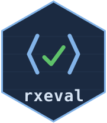

# rxeval 

Runs the logic inside an ODK/OpenRosa form — `relevant`, `constraint`,
`required`, `calculate` — from R, before the field and after it.

A form is a small program. Until something runs it, an analysis script can
only take whatever the devices sent and hope the devices were right. rxeval
is that something: it evaluates the questionnaire's own rules over collected
data and answers what the form says — and it reads a form the way **both**
engines in the ecosystem do, JavaRosa (ODK Collect, KoboCollect) and Enketo
(web forms), so it can also say where the two will disagree before anyone
collects a byte.

The engine is the [rxeval Rust crate](https://milkway.github.io/rxeval/);
this package is the same engine compiled into R, not a reimplementation.

## Installation

The package compiles its engine on installation, so it needs a
[Rust toolchain](https://rustup.rs) (`rustc` ≥ 1.65):

``` r
# install.packages("remotes")
remotes::install_github("milkway/rxeval", subdir = "r-package")
```

## What it answers

Three functions, three questions:

``` r
library(rxeval)
library(dplyr)

form       <- system.file("extdata", "visit.xml", package = "rxeval")
submission <- system.file("extdata", "visit-submission.xml", package = "rxeval")

# Which of the form's own rules does this submission break?
submission_findings(form, submission) |>
  as_tibble()
#> # A tibble: 3 × 3
#>   path                   kind        says
#>   <chr>                  <chr>       <chr>
#> 1 /data/youngest_entered calculation /data/youngest_entered: holds "", but…
#> 2 /data/residents        constraint  /data/residents: More than 20 reside…
#> 3 /data/respondent       required    /data/respondent: required, and unan…

# Will this form mean the same thing on a tablet and in a browser?
form_portability(form) |>
  filter(breaks == "Collect / KoboCollect") |>
  select(path, construct, suggestion)
#>                     path construct            suggestion
#> 1 /data/youngest_entered    last() count() of the repeat

# What does this rule do, before it goes into the spreadsheet?
eval_expression("count(/data/resident[age < 18])", submission)
#> [1] "1"
```

A rule the engine could not evaluate comes back as `not-evaluated`, never as
a pass: a rule that did not run has not been satisfied, and reporting it as
clean would be the one failure worth avoiding.

## The rest of the family

- [rxform](https://github.com/milkway/rxform) turns an
  [XLSForm](https://xlsform.org) spreadsheet into the XForm this package runs.
- [The project site](https://milkway.github.io/rxeval/) explains the method:
  every rule in the engine was decided by putting the same expression to both
  reference implementations and reading the two answers.
